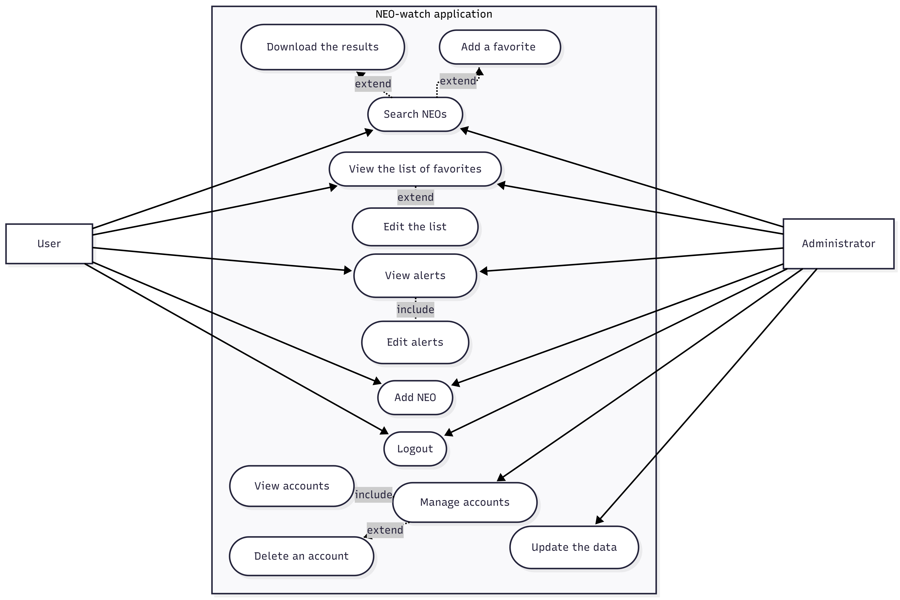
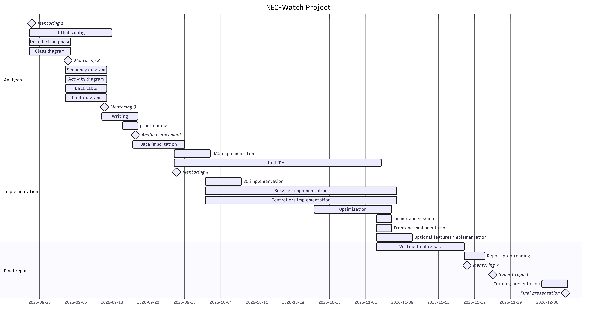
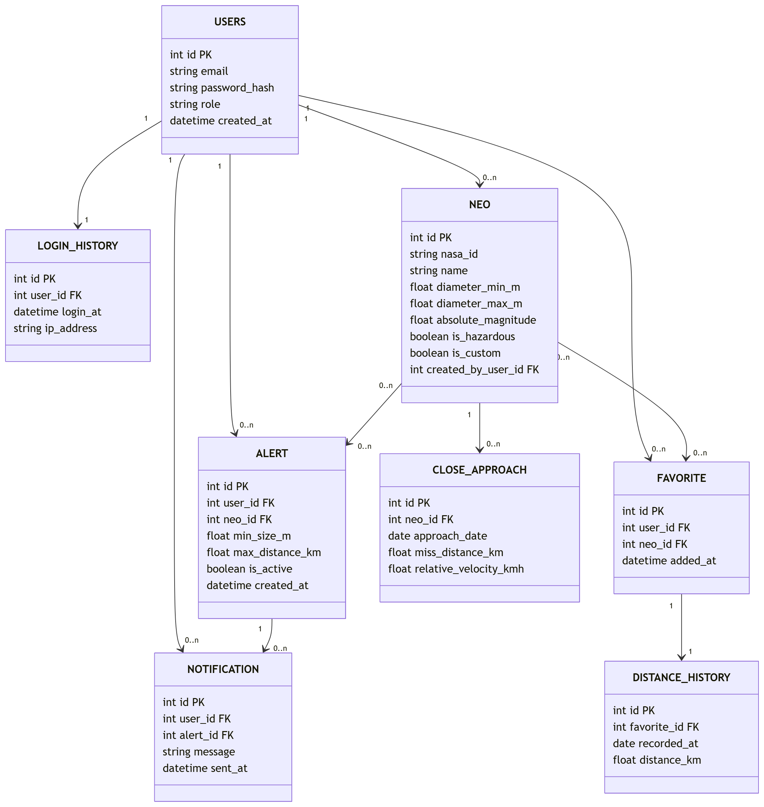
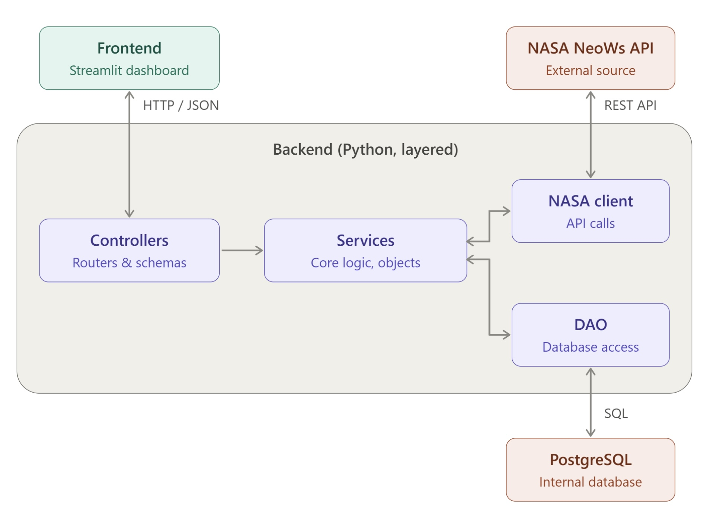
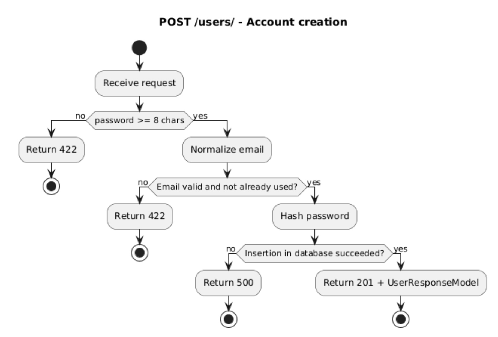
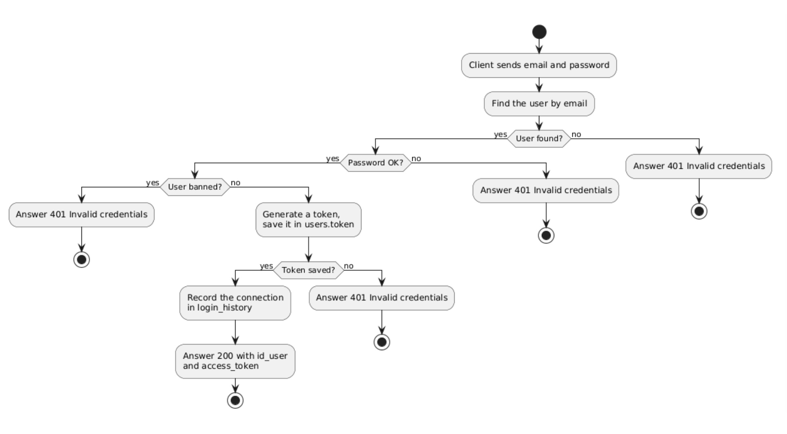

\begin{titlepage}
\centering

{\LARGE\textsc{IT project}}\\
\vspace{0.5cm}
{\large Student 2nd year}

\vspace{2.5cm}

\rule{\textwidth}{0.5mm}\\
\vspace{0.8cm}
{\huge\bfseries Final report: NEO-Watch}\\
\vspace{0.8cm}
\rule{\textwidth}{0.5mm}\\

\vspace{2.5cm}

\begin{flushleft}
\emph{Students :}\\
Yann Malzieu\\
Faustine Barbeau\\
Jules Frulli\\
Abderrahmane Taleb Amar\\
\end{flushleft}

\begin{flushright}
\emph{Tutor :}\\
Olivier Ricciardi\\
\vspace{1.0cm}
\end{flushright}

\vfill 
\begin{center}
ENSAI\\
2026--2027
\end{center}
\end{titlepage}

\renewcommand{\contentsname}{Table of content}
\tableofcontents

\renewcommand{\listfigurename}{List of figures}
\listoffigures

# Introduction

Fascinated by the night sky, or by movies where an asteroid is hurtling straight toward Earth? Then NEO-Watch is made for you!

NEO-Watch is a web application for tracking asteroids passing near Earth, which scientists call NEOs (Near-Earth Objects). It lets you search for an asteroid by its characteristics (name, size, flyby date, etc.) and view its profile: diameter, brightness, miss distance, speed, and whether NASA classifies it as potentially hazardous.

Users who create an account get access to a personal space. They can build a list of favorite asteroids and track how their distance from Earth changes over time on a chart. They can also set custom alerts, for example, "notify me when an asteroid larger than 100 meters passes within 5 million kilometers of Earth": if a flyby matches, a notification appears the next time they log in. Finally, they can create their own asteroids. Meanwhile, administrators manage accounts, check login history, and trigger data updates.

**What needs does it address ?**

NASA publishes data on these asteroids for free via an API that is, an internet service designed for programmers. The data comes in raw form (JSON format, a structured text meant to be read by machines), mixes multiple units of measurement, and covers tens of thousands of objects. A curious user can't make sense of it as is. NEO-Watch addresses four needs:

- Understand and explore: A clear presentation of asteroids (size, miss distance, speed, date, potentially hazardous status), complete with a dashboard, searches by criteria (name, size, flyby date, etc.), sorting, and exports.
- Track what interests you: Each user builds their list of favorite asteroids and views how each one's distance from Earth evolves on a chart.
- Get notified: Users set their own alerts, such as "notify me when an asteroid larger than 100 meters passes within 5 million kilometers of Earth." If a flyby matches, a notification appears upon their next login.
- Experiment and contribute: Users can create their own asteroids to record a personal observation or imagine a scenario. These objects are protected: updates with NASA data do not overwrite them.

Processing the data posed several challenges. The data is organized by date in a nested structure, and the same measurements are repeated in multiple units. Some asteroids have missing information. A single asteroid can have many flybys, both past and future. Values are also revised by NASA as new observations come in, meaning our database must be able to resynchronize without losing user-created data. We therefore convert them into a single format (meters, kilometers, km/h) and store them in a database.

**Data generated by the application**

In addition to NASA's data, NEO-Watch records:

- user accounts (email address, password stored in encrypted form, role) and login history;
- each user's favorites, along with the distance history of each tracked asteroid;
- alerts (distance threshold, optional minimum size, whether aimed at a specific asteroid or not);
- custom asteroids, flagged as such along with their creator.

# I. The app's objectives to meet user needs

The app must offer certain main features. We focus here on four structuring aspects: user management, the dashboard, alerts, and the use of NASA's API. 

**User and access management**. The application handles personalised data (favourites, alerts, history) specific to each person, so access must be secured and individualised. We distinguish two profiles for this purpose. The standard user has an account giving access to their personal space and to the viewing features. The administrator is a particular user with additional rights: they manage other users' accounts, view the connection history, and trigger data updates. This separation of roles meets a security need, since certain sensitive actions must only be accessible to an identified manager. Passwords are never stored in plain text, but in a protected form.

**Dashboard**. A user who logs in wants quick access to useful information, without having to perform a search every time. The application therefore offers a dashboard summarising the essentials upon login: the upcoming objects approaching Earth, the number of potentially hazardous objects among these approaches, or the closest object over a given period. This dashboard is partly personalised, notably by displaying the asteroids the user has marked as favourites, so that everyone finds the objects that interest them first.

**Alerts**. A user cannot continuously monitor the entire catalogue, so they need to be notified automatically when a relevant event occurs. The application therefore lets them define personalized alerts, expressing a condition of their choice (for example, being notified when an asteroid larger than a certain size passes within a certain distance of Earth). These alerts are evaluated when the user logs in: if an event matches one of their conditions, a notification is presented to them. This login-based approach avoids continuous monitoring while ensuring that the user is informed as soon as they return to the application.

**Use of NASA's API**. The data on near-Earth objects comes from NASA's public API. Rather than querying this API at each user action, the application keeps a copy of it in its own database, updated by the administrator. This choice ensures fast response times and limits the number of requests sent to NASA. It does, however, imply a particular requirement: the application must distinguish objects originating from NASA from those added by the users themselves, so that the latter are never overwritten during updates.

Our app also offers two optional features. 

**NEO comparison**. Users often need to evaluate multiple near-Earth objects side by side rather than consulting their records individually. To meet this need, the application allows users to select several asteroids and compare their key characteristics, such as size, velocity, miss distance from Earth, approach date, and hazard level. The results are displayed in a structured comparison table as well as an exportable chart, making it easier to spot differences and identify the most notable objects at a glance.

**Proposing modifications to a NEO**. Since users may act as amateur astronomers with their own observations, the application gives them the ability to suggest corrections or updates to certain data associated with a NEO. When a user submits a modification proposal, the administrator is automatically notified so they can review the request. However, the workflow intentionally stops at this notification stage: external data fetched from NASA's public API remains read-only and is never altered directly by user submissions, preserving the integrity of the official catalogue.

# II. Project organization and planning 

To ensure the successful completion of the implementation project, we have decided to organise ourselves as follows.

We opted for a more flexible approach without assigning everyone a specific role. This enabled us to understand every stage of the app's development and to help one another. After agreeing on the app's overall structure (analysis report), we divided up the various key features amongst ourselves, from DAOs to controllers. As things progressed, certain roles naturally fell into place. For example, Yann made sure that the weekly tracking was updated regularly. This organisation ran smoothly thanks to the small size of our team and good communication via meetings and the WhatsApp group. At each meeting, we would list the tasks we had completed and identify those that needed to be done before the next deadline we had set ourselves, so that we could make steady progress.

When it came to working as a team, GitHub proved to be a very useful tool for keeping the project up to date and enabling us to work simultaneously. By dividing the work into major features, we were able to avoid file versioning conflicts. 

# III. Application design

## A. Database

The data about Near-Earth Objects (NEOs) is retrieved automatically through the endpoints of NASA's NEO API. This API provides extensive information about asteroids, including their orbital caractéristiques, physical properties and close-approach predictions. 

However, the API returns far more data than our application actually needs. We therefore chose a selective approach: only information considérés useful for the application is extracted and stored in the database. This includes the NASA identifier, the object's name, its estimated diameter range, its absolute magnitude and esther it is classified as potentially hazardons, along with the details of its close approaches to Earth (date, orbitant body, miss distance and relative velocity). This deliberate filtering keeps the database lightweight, simplifies queries and avoids storing redundant or unused fields.

The database is organized around two central entities (`users` and `neo`) with all other tables depending on them through foreign keys. As shown in the table diagram (figure ?), every relationship follows a one-to-many (1 : N) pattern, with a single exception. 

The `users` table anchors account management. It connects to `login_history` when the user log in, `alert` when they are configured, `favorite` when the user adds a neo as a favorite, and `neo` when he creates its own NEOs. 

The `neo` table anchors the astronomical data. It connects to `close_approach` the close approach history of a NEO, `favorite` where a NEO can be saved by a user and `alert` to trigger them when they are configured by users.

The only deviation from the standard pattern is the `neo` and `alert` link: since `alert.id_neo` is nullable, an alert can either target a specific NEO (0..1 : N) or be generic and triggered by any object crossing the configured thresholds. 

In short, the schema separates who uses the application (`users`, `login_history`), what is observed (`neo`, `close_approach`) and how users interact with data (`alert`, `favorite`, `distance_history`).

To store this database, we use PostgreSQL which we connect to via the `.env` file. This system allows multiple users to view and edit the database at the same time.

**Database updates.** Because NASA continuously refines orbital parameters and publishes new close-approach predictions, the local PostgreSQL database must be refreshed periodically without disrupting active users or overwriting custom asteroids. Rather than querying NASA's API on every user request, updates are triggered explicitly by an administrator through the `POST /admin/import` endpoint.

The update workflow relies on a dedicated synchronization script (`utils.weekly_data`) executed in an isolated background subprocess (`subprocess.run`) so that the API remains responsive and immediately returns a `202 Accepted` status. To prevent concurrent writes or duplicate API bursts, a shared thread lock (`threading.Lock`) ensures that only one synchronization runs at a time, rejecting overlapping requests with a `409 Conflict` error.

Because NASA's `/feed` endpoint restricts queries to a seven-day window, `sync_weekly_feed` computes a rolling seven-day interval ending on the current date (`end - 6 days` to `end`) and delegates the ingestion to `NeoService.sync_nasa_data`. For each retrieved object, the service performs a non-destructive upsert:

- **Existing NASA NEOs** (matched by `nasa_id`) have their physical and orbital attributes updated without altering their internal primary key (`id_neo`), preserving existing user alerts and favorites.
- **Close approaches** are deduplicated against existing `(id_neo, orbiting_body, approach_date)` records so that repeated runs only insert newly detected flybys.
- **User-created NEOs** (`is_custom = True`) carry synthetic identifiers (`CUSTOM-...`) and are never touched by the synchronization process, guaranteeing full data integrity across updates.

## B. Architecture

Our project is a client-server application. The client (frontend) and the server (backend) communicate through HTTP requests and exchange data in JSON format. The application is built around four major components.

**Backend**

Developed in Python, the backend centralizes the application logic. It follows the classic layered model seen in class, in order to strictly separate responsibilities:

- Controllers & schemas: expose the API endpoints through routers and handle the HTTP requests coming from the client.
- Services & business objects: the core of the system. They contain all the business logic, such as alert processing, favorites management and the creation of objects.
- DAO: the software layer dedicated to interactions with the PostgreSQL database.
Client: the code that communicates with the NASA API.

**Frontend**

Developed in Python with the Streamlit library, which makes it possible to generate interactive dashboards. It collects the user's actions and displays the data.

**Internal database**

We use the PostgreSQL relational database management system, which ensures the integrity of our data.

**External data source**

To feed the application, the backend retrieves data from the NASA NeoWs API. The data is then filtered, transformed and inserted into our own PostgreSQL database.

Architecture diagram

## C. Features' implementation

All features follow the same structure: the layered architecture. The Pydantic models (`schema/`) are separate from the business objects: for example, `UserResponseModel` never contains `password_hash` or `token`, so sensitive data cannot leak through API responses. Each section below presents the endpoints (with the required access level) followed by the design choices of the feature.

### 1. User (/users)

| Endpoint | Purpose | Access | Success | Errors |
|---|---|---|---|---|
| POST /users/ | Account creation | Public | 201 + user | 422 (invalid data), 500 (insertion failed) |
| POST /users/logout | Close the session | Token required | 204 | 401 (unknown or already closed token) |
| GET /users/me | Profile of the logged-in user | Token required | 200 + user | 401 (via the dependency) |

**Registration.** The service normalizes the email (lower case, surrounding spaces removed), checks its format, the password length (8 characters minimum) and the uniqueness of the email. The password is never stored in clear text. It is hashed with a random salt unique to each user. The salt and the iteration count are stored inside the hash string, so these parameters can evolve without breaking existing accounts.

**Logout and authentication.** A session is a random token (`secrets.token_urlsafe`) stored in the `users` table. Logging out sets this token back to `None`. On every protected request, `authenticate` finds the user by token and refuses access if the user is banned, so a ban takes effect immediately without waiting for a session to expire.

### 2. Admin (/admin)

| Endpoint | Purpose | Access | Success | Errors |
|----|---|--|---|---|
| POST /admin/users/{id_user}/ban | Ban a user | Admin | 204 | 400 (unknown user, admin, or self), 500 |
| POST /admin/import | Start the NASA data import | Admin | 202 | 409 (import already running) |
| GET /admin/connections | Connection history (filterable by id_user) | Admin | 200 + list | 404 (unknown user) |

**Access control.** Rights are checked at two levels: the `require_admin` dependency in the controller, and `_require_admin` in the service. The service therefore stays protected even if it is called from an entry point other than the API.

**Ban.** The service refuses self-bans and bans of other admins. It sets `is_banned` to `True` and removes the token, which closes the current session. The user cannot log in again, since login refuses banned accounts.

**Data import.** This is the most interesting feature technically, because the import to update the data is long (timeout set to 1 hour). Three design choices:

- the import runs in a subprocess (`subprocess.run`), isolated from the API, with a timeout;
- the endpoint immediately returns `202 Accepted` and delegates the work to a FastAPI `BackgroundTask`, whose outcome only appears in the logs;
- a lock (`threading.Lock`, shared between instances) ensures that only one import runs at a time. The controller checks `is_import_running()` to return 409, and the service also performs a non-blocking acquire. This second protection covers the case where two requests arrive simultaneously.

**Connection history.** The endpoint delegates to the history service (all users, or a single user after checking that they exist). This history feeds the connections section.

### 3. Login and connections (/login, /connections)

Login checks who the user is and opens a session; connection history keeps a trace of every successful login, which the administrator can consult.

| Endpoint | Purpose | Access | Success | Errors |
|---|---|---|---|---|
| POST /login/ | Check the credentials, open a session and record the connection | Public | 200, with `id_user` and `access_token` | 401 (wrong email or password, or banned user) |
| GET /connections/ | List the connections: all of them for an administrator, only his own for a regular user | Token required | 200, list of connections | 401 (missing or invalid token), 404 (no connection) |
| GET /connections/users/{id_user} | List the connections of one user | Token required | 200, list of connections | 404 (no connection for this user) |

A connection is returned as `id_login`, `id_user` and `login_at` (the date and time of the login), described by the `ConnectionReadModel` schema. Like the `UserResponseModel` of the user feature, this schema is separate from the business object, so only the intended fields leave the API.

**How a login works.** The client sends the email and the password. The controller gives them to `UserService.login`, which does all the checking. Only if the login succeeds does the controller call `ConnectionHistoryService.create` to record the connection, and then it returns the token. Several choices here are worth explaining:

- **Same answer for every refusal.** An unknown email, a wrong password and a banned account all give the same `401 Invalid credentials`. An attacker cannot use the application to find out which emails have an account, or which accounts are banned. The ban is checked after the password for the same reason.
- **A salted hash, compared in constant time.** The stored password is a PBKDF2-SHA256 hash with a random salt. The comparison uses `hmac.compare_digest`, whose duration does not depend on how many characters match.
- **The history never blocks the login.** Recording the connection is secondary information. If it fails (for example if the database refuses the insertion), the error is written in the logs and the user is still logged in.
- **A new token at each login.** The token is generated with `secrets.token_urlsafe`, the standard module for secrets, and replaces the previous one.

**How a protected request is checked.** After the login, the client sends the token in the header `Authorization: Bearer <token>`. Three small functions of `dependencies.py` are chained by FastAPI before the endpoint code runs:

- `get_token` reads the header and answers `401 Not authenticated` if it is missing.
- `get_current_user` asks `UserService.authenticate` for the owner of the token. A token that does not exist, or whose user is banned, gives `401 Invalid or expired token`.
- `require_admin` additionally answers `403 Admin rights required` if the user is not an administrator.

The endpoint itself only receives the authenticated user and does not repeat these checks. In `GET /connections/`, the same endpoint serves both roles: the administrator receives every connection and the regular user receives only his own, after filtering in the controller. A regular user can therefore never read the history of someone else through this endpoint. The token has no expiration date: a session ends when the user logs out or when an administrator bans him, both of which remove the token from the database.

### 4. NEOs (/neo)

| Endpoint | Purpose | Access | Success | Errors |
|---|---|---|---|---|
| GET /neo | Search NEOs (filters + optional sort) | Token required | 200 + list | 400 (unknown sort key) |
| GET /neo/export | Export filtered NEOs as a CSV or JSON file | Token required | 200 + file | 400 (unsupported format) |
| GET /neo/compare | Compare several NEOs and their closest Earth approach | Token required | 200 + list | 404 (unknown NEO), 422 (fewer than 2 IDs) |
| GET /neo/nasa/{nasa_id} | Get a NEO by its NASA identifier | Token required | 200 | 404 (unknown `nasa_id`) |
| GET /neo/{id_neo} | Get a NEO by its id | Token required | 200 | 404 (unknown NEO) |
| GET /neo/{id_neo}/close-approaches | List the close approaches of a NEO | Token required | 200 + list | 404 (unknown NEO) |
| POST /neo | Create a custom NEO | Token required | 201 | 400 (missing name) |
| DELETE /neo/{id_neo} | Delete a NEO | Token required | 204 | 404 (unknown NEO) |
| POST /neo/sync/feed | Synchronize the NEOs of a date window (7 days max) | Admin | 200 + summary | - |
| POST /neo/sync/page | Synchronize one page of the full NASA catalog | Admin | 200 + summary | - |

**Search.** Filtering happens in two stages inside `search_neos`: a filter runs in SQL with criterion as `nasa_id`, `user_id`, or `is_hazardous`, then refined filtering runs in Python to combine all remaining criteria: case-insensitive name substring, mean-diameter range, magnitude bound, and close approaches via `CloseApproachDao` (`orbiting_body`, `approach_date`). Sorting (`sorting_neo_by`) is also done in Python, driven by the `SORT_KEYS` dictionary; NEOs with a missing value always come last, and an unknown sort key returns 400.

**Export.** The service writes the `EXPORT_FIELDS` fields to a temporary file (CSV or JSON). The controller streams that file through a `FileResponse` with a `BackgroundTask` that deletes the temporary file once the response has been sent, so nothing accumulates on disk.

**Comparison.** The controller exposes `GET /neo/compare`, relying on FastAPI's `Query(..., min_length=2)` to enforce at least two `ids` query parameters (automatically returning `422` otherwise) and preserving the requested order. In `NeoService.compare`, each `id_neo` is first resolved via `get_by_id_neo` raising a `404` as soon as an unknown identifier is encountered—before querying `CloseApproachDao().find_by_id_neo(id_neo)`. The service filters the approaches to retain only those orbiting `EARTH` with a non-null `miss_distance_km`, and selects the minimum distance (`default=None` if the NEO has no recorded Earth approach, such as objects orbiting another body or newly created custom NEOs). Finally, the controller serializes each `(Neo, CloseApproach | None)` pair through `_comparison_to_out` into a `NeoComparisonOut` schema, allowing the frontend to render a side-by-side table, a CSV export, and interactive comparison charts.

**Custom NEO creation.** The controller sets `is_custom=True` and generates a synthetic identifier (`CUSTOM-<uuid8>`) when the client does not supply one, distinguishing user-created entries from NASA-imported objects. The service enforces only one rule: a NEO must have a name (400 otherwise).

**NASA synchronization.** Two entry points delegate to `NasaClient`, which queries the NASA API (`/feed` for a date window, `/browse` for a page of the paginated catalog) and maps the response into `Neo` + `CloseApproach` objects. The shared persistence step, `_save_neos`, inserts each NEO together with its approaches under the newly assigned `id_neo`, and is fault-tolerant per NEO: a failure is logged and counted without interrupting the batch, and the endpoint returns a summary (`synchronized_neos`, `synchronized_approaches`, `errors`). Duplicate approaches are skipped because `CloseApproachDao().create()` returns `True` only for a new insert.

### 5. Alerts (/alerts)

An alert watches a NEO (or all of them, for generic alerts) and fires when its next close approach to Earth gets closer than the user's distance threshold, optionally also requiring a size threshold. The schemas (`AlertIn`, `AlertUpdate`, `AlertOut`, `TriggeredAlertOut`) are separate from the business objects and embed the watched NEO through `NeoOut`, so the client receives everything it needs for display in one call.

| Endpoint | Purpose | Access | Success | Errors |
|-----|---|--|---|---|
| POST /alerts | Create an alert for a user, on one NEO or generic | - | 201 + alert | 422 (`threshold_km` ≤ 0), 404 (unknown NEO), 409 (NEO already watched), 500 (insertion failed) |
| GET /alerts/{id_user} | List the NEOs watched by a user (most recent alert first), each with its NEO | - | 200 + list | - |
| GET /alerts/{id_user}/triggered | List the upcoming close approaches that trigger an active alert | - | 200 + list | - |
| PATCH /alerts/{id_user}/{id_alert} | Modify an alert (only the fields sent are changed) | - | 200 + alert | 404 (unknown alert) |
| DELETE /alerts/{id_user}/{id_alert} | Delete an alert | - | 204 | 404 (unknown alert) |

**Targeted and generic alerts.** `id_neo` is nullable, which gives two modes in a single model: a targeted alert watches one specific NEO (404 if it does not exist), while a generic alert watches every NEO. In the list, a generic alert comes back with `neo: null`, so the client can tell the two apart.

**One alert per NEO.** The service refuses a duplicate with `409 This NEO already has an alert`, and a failed insert surfaces as an explicit 500. Consistency is therefore enforced by the service rather than trusted to the client.

**Ownership before anything else.** Update and delete first resolve the alert through `_find_user_alert`, which looks only through *that user's own alerts* and raises 404 if it is not there: a user can never modify or delete someone else's alert, even by guessing an `id_alert`. Patching is also allow-listed: only the fields listed in `UPDATABLE_FIELDS` (`threshold_km`, `threshold_size`, `is_active`) are copied, unknown keys are silently ignored.

**Trigger evaluation.** `check_alerts` is the most interesting part. It skips inactive alerts and alerts without a distance threshold. Then, depending on the alert type: a targeted alert fetches the approaches of that one NEO, while a generic alert uses a SQL pre-filtered query (`find_upcoming`) that already applies the date, distance, body (Earth), and size threshold in the database. In BOTH cases, the final rule is re-checked in Python by `_is_triggered`: Earth only, upcoming approach (date ≥ today), `miss_distance_km` ≤ `threshold_km`, and if `threshold_size` is set, the NEO's maximum diameter must reach it. The service keeps a single definition of "triggered" no matter the entry path, with the SQL query acting only as a performance coarse filter. The result embeds the alert, its NEO and the triggering approach (`TriggeredAlertOut`), so the frontend can show exactly *why* an alert fired.

### 6. Favorites (/favorites)

A favorite pins a NEO for a user, and each favorite carries its distance history: the NEO's miss distances over time, available as raw data or as a chart. The schemas wrap the NEO (`FavoriteOut` with `NeoOut`) the same way the alerts feature does.

| Endpoint | Purpose | Access | Success | Errors |
|----|---|---|---|---|
| POST /favorites | Add a NEO to the favorites of a user | - | 201 + favorite | 404 (unknown NEO), 409 (already a favorite), 500 (insertion failed) |
| GET /favorites/{id_user} | List the favorites of a user (most recent first), each with its NEO | - | 200 + list | - |
| DELETE /favorites/{id_user}/{id_neo} | Remove a NEO from the favorites | - | 204 | 404 (not a favorite) |
| GET /favorites/{id_neo}/distances | The miss distances of a favorite NEO over time, sorted | Current user (via `get_current_user`) | 200 + history | 404 (not a favorite, unknown NEO) |
| GET /favorites/{id_neo}/distances/chart | PNG chart of the miss distances | Current user (via `get_current_user`) | 200 + PNG image | 404 (not a favorite, no approach data) |

**Robust add and list.** Adding checks that the NEO exists (404), that it is not already a favorite (409), and surfaces a failed save (500). When listing, a favorite whose NEO no longer exists is silently skipped instead of breaking the whole response the list stays usable even after referential drift.

**Ownership comes from the token, not the path.** On the two `distances` endpoints, the user is never taken from the URL: the controller injects `get_current_user` and passes `current_user.id_user` to the service. Changing the URL cannot expose another user's distance history the same pattern as the Login section (identity comes from the session, never from the request itself). The service also verifies ownership: 404 if the NEO is not in *that user's* favorites.

**Distance history.** The service builds the points from close-approach data, with a case-insensitive `orbiting_body` filter, sorts the points chronologically, and highlights the `closest` point the frontend receives both the curve and its minimum in a single call.

**Chart rendering.** The PNG chart is a good example of engineering care:

- the service uses a matplotlib `Figure` object instead of `pyplot`, which keeps no global state and is therefore safe to call from FastAPI's thread pool;
- one line (and one color) is drawn per orbited body, so approaches around different bodies do not blend together;
- when the distances span several orders of magnitude (max/min ratio > 100), the axis automatically switches to a logarithmic scale to stay readable;
- the image is rendered into an in-memory buffer (`BytesIO`) and returned as raw bytes no temporary files to clean up.

**Tolerant date parsing.** Approach dates come from NASA in its own format (`2026-Oct-23 12:00`) or from the database in ISO format. The service tries the NASA format first, then ISO, and skips with a warning any point whose date or distance is unreadable one dirty record bends the chart rather than breaking the request.

## Concrete example: Browse NEOs

**What the feature does**

NASA publishes data on tens of thousands of near-Earth asteroids, but in a raw form that only programs can read. The Browse NEOs feature turns this data into something a person can explore. A user can look for an asteroid by name, NASA identifier, size, brightness, hazardous classification, orbited body (e.g. the Earth) or date of a close approach; sort the results; open a detailed sheet (size, brightness, danger level, every close approach with its distance and speed); export the results as a CSV or JSON file; and compare asteroids side by side.

Browsing is the most used feature of NEO-Watch, and the one the other features rely on: a favorite, an alert or a custom NEO always points to a NEO found through it.

**Use case diagram**

The diagram below shows who can do what. The actor *user* is a person with an account; the *administrator* is a user with extra rights; the *NASA API* is the external system that feeds the database.

Two shortcuts are worth reading: the administrator inherits everything the user can do, and the diagram keeps two fine-grained actions *search* includes *sort*, because every search request can carry a sort criterion, and *NEO sheet* includes *close approaches*, because they are always displayed with it.

**Class diagram**

The diagram is limited to the classes involved in browsing, one layer per row. An arrow means *uses* (the class on the left calls the one on the right), not inheritance no class here inherits from another. The layers are only coupled downwards, which is what allows each layer to be tested or replaced alone. Three points are worth explaining:

- **The controller never talks to a DAO.** It calls `NeoService`, which applies the business rules (combining the filters, sorting, refusing an unknown sort criterion) and is the only class that calls the DAOs.
- **Business objects and API schemas are separate classes.** `Neo` and `CloseApproach` circulate between the service and the DAOs and contain neither SQL nor HTTP code. `NeoOut`, `CloseApproachOut` and `NeoComparisonOut` define what the API sends back; the controller converts one into the other, so a change in the database does not change the contract with the frontend.
- **The two DAOs do not call each other.** A close approach is linked to its NEO only through the identifier `id_neo`, exactly as in the database.

**From the interface to the backend**

When the user interacts with the frontend, the fields they fill and the buttons they click become HTTP calls against the REST endpoints exposed by `neo_controller.py`. Let us follow one concrete example: a search for a NEO named "my neo", limited to the NEOs the user created themselves.

In the interface, the user types the name and checks the box "Is custom". The frontend builds a `GET` request against the search endpoint with the matching parameters: `name=my neo` and `user_id=<id of the logged-in user>`, plus the optional sort parameters `sort_by` (field to sort on) and `descending` (sort direction). The controller receives the request, validates it, and delegates the actual data retrieval to the service layer. Once the service returns the results, the controller converts them with the `NeoOut` schema which defines the exact structure of the response and the type of each field so the frontend always receives predictable, consistently formatted data.

The same controller exposes every browsing action: multi-criteria search, export, retrieval by id or by NASA identifier, close approaches of a NEO, creation and deletion of a NEO, and the two NASA synchronization entry points.

**Service layer**

The service (`NeoService`) turns the search criteria into database calls, in two stages. A coarse filter selects the DAO method: `find_by_id_nasa` for an exact NASA identifier, `find_all_by_id_user` for the NEOs of one user, `find_by_hazardous` for the hazardous flag, or `find_all` otherwise. In our example, the "Only the NEOs I created" box sets `user_id`, so the service calls `find_all_by_id_user`. The remaining criteria are then applied in Python and logically ANDed: case-insensitive name substring, mean-diameter range, magnitude bound, and close approaches, obtained by asking `CloseApproachDao` for the matching `orbiting_body` or `approach_date`. Sorting is done by `sorting_neo_by`, driven by the `SORT_KEYS` dictionary; NEOs with a missing value come last, and an unknown sort criterion is refused with 400.

**Data access layer (DAO)**

All DAO classes rely on `DBConnection`, a singleton that opens a single PostgreSQL connection with the psycopg2 library and shares it across the application. The connection parameters (host, port, database, user, password) and the schema name (`NEOW`) are read from environment variables, so no credential is written in the code. Because the schema is set as the search path of the connection, the queries only need the table names. The connection uses a `RealDictCursor`, which returns each row as a dictionary whose keys are the column names the dictionaries read by the conversion methods.

The NEOs are handled by `NeoDao`, a singleton and the only place where SQL queries on the `neo` table are written. It offers one method per type of query `find_all`, `find_by_id_neo`, `find_by_id_nasa`, `find_by_hazardous`, `find_all_by_id_user`, plus creation, update and deletion. In our example, the service calls `find_all_by_id_user`, which executes the parameterized query equivalent to `SELECT * FROM neo WHERE created_by_user_id = <user id>`: the value is passed separately from the query text, which protects against SQL injection. On error, the DAO logs the problem and raises the exception again, so the upper layers decide how to handle it.

The close approaches have their own DAO, `CloseApproachDao`, built the same way:

- `find_by_id_neo`: all the close approaches of a given NEO;
- `find_by_orbit`: all the close approaches around a given orbiting body (e.g. the Earth);
- `find_by_approach_date`: all the close approaches on a given date;
- `find_upcoming`: the upcoming close approaches below a distance, used by the alerts; it joins the `close_approach` and `neo` tables to also filter on the size of the NEO.

All these methods return lists of `CloseApproach` objects.

**Relationship between NEOs and close approaches**

A NEO can have several close approaches, and each close approach belongs to a single NEO. This one-to-many relation is carried by the foreign key `id_neo` of the `close_approach` table, which references the primary key of the `neo` table. The two DAOs never call each other; the link is only this identifier.

- During a search. When the user filters on an orbiting body or an approach date, the service asks `CloseApproachDao` for the matching close approaches, collects their `id_neo`, and keeps, among the NEOs already found, only those whose `id_neo` is in that set.

- During a NASA synchronization. For each NEO retrieved from the NASA API, the service first saves it with `NeoDao.create`, which inserts it or updates it if a NEO with the same `nasa_id` already exists and retrieves the `id_neo` generated by the database. This identifier is then copied into each close approach of the NEO, saved with `CloseApproachDao.create`. Before inserting, this method looks for a close approach with the same NEO, orbiting body and date: if one exists it returns `False` and nothing is inserted, otherwise the row is inserted and the generated identifier is stored in the object. This duplicate check is what allows the administrator to refresh the database without creating duplicates.

**Database**

The data is stored in a PostgreSQL database, in the `NEOW` schema. Each row of the `neo` table describes one NEO: its primary key `id_neo`, its NASA identifier `nasa_id`, its name `name_neo`, its minimum and maximum diameters in meters, its absolute magnitude, and two booleans `is_hazardous` and `is_custom`. The `is_custom` boolean distinguishes the NEOs created by users from the ones imported from NASA, and `created_by_user_id` a foreign key to the `users` table links a custom NEO to the user who created it. This is the column used in our example. The `close_approach` table contains, for each approach, the orbited body, the date, the miss distance in kilometers and the relative velocity in kilometers per hour, linked to its NEO by `id_neo`.

**Business objects**

The DAOs do not return raw database rows. Each row of the `neo` table is converted by `_row_to_neo` into a `Neo` business object, with one attribute per column: `id_neo`, `nasa_id`, `name_neo`, `diameter_min_m`, `diameter_max_m`, `absolute_magnitude`, `is_hazardous`, `is_custom` and `created_by_user_id`. Each row of the `close_approach` table is converted by `_row_to_approach` into a `CloseApproach` with the attributes `id_approach`, `id_neo`, `approach_date`, `orbiting_body`, `miss_distance_km` and `relative_velocity_kmh` note that the `id_close_approach` column becomes the `id_approach` attribute, and the date, a `DATE` in the database, becomes a string. A `CloseApproach` does not embed the `Neo` it belongs to, only its `id_neo`, exactly the link used in the database. These objects are what circulates between the layers: the DAOs return lists of `Neo` and `CloseApproach` to the service.

## E. User interface

## F. Application quality

To ensure the quality of the code throughout the project, we reviewed the code written by other team members, in particular to ensure consistency in the use of variables, naming conventions, and shared patterns across modules. Furthermore, unit tests were carried out in parallel with the coding of the DAOs and services to validate business rules, edge cases, and database interactions, and to improve the reliability of the methods. We focused our testing on these two layers as they are essential to the application's operation and data integrity.

The quality of the controller code is verified when the endpoints are used within the frontend, allowing us to check request handling, status codes, authentication/authorization behavior, and end-to-end data flow. It was in this context that the application logs proved particularly useful: they enabled us to trace execution flow, identify the source of errors, and inspect the sequence of functions that had been executed before a failure occurred. To run the tests, we used `pytest`, and to ensure adequate test coverage, we used coverage tooling alongside Python 3 on the DAO and service layers, reaching 91% coverage and helping us spot remaining uncovered branches and edge cases. 

To keep code style uniform across the team, we checked formatting, line length, imports, and syntax consistency using style tooling (`flake8` and `Ruff), refactoring overly long expressions or inconsistent blocks as we went. In addition, we documented classes, functions, and endpoints with structured docstrings (describing behavior, arguments, return values, and raised exceptions) and added targeted inline comments to clarify complex logic, SQL queries, and non-obvious constraints, making the codebase easier to read, maintain, and review.

# Personal feedbacks

# Conclusion